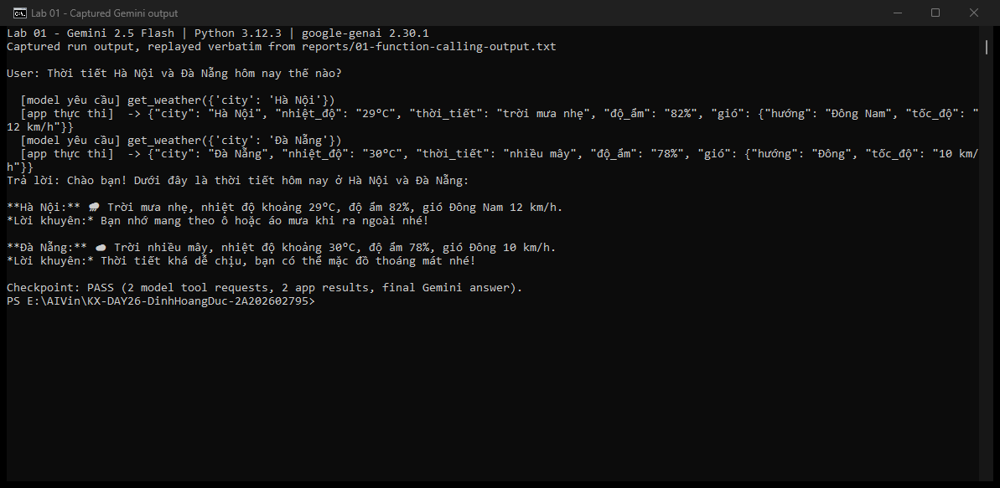
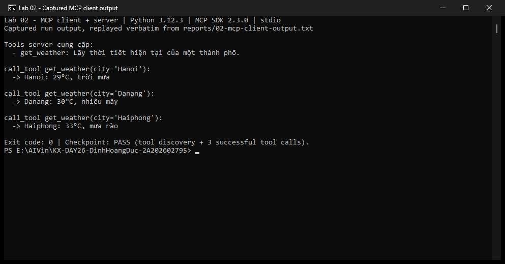
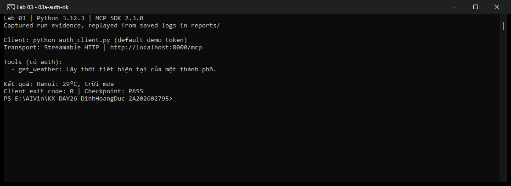
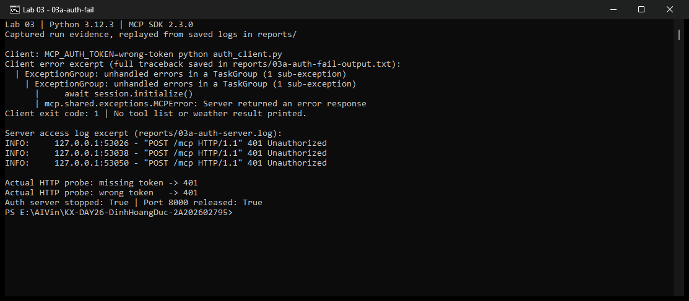
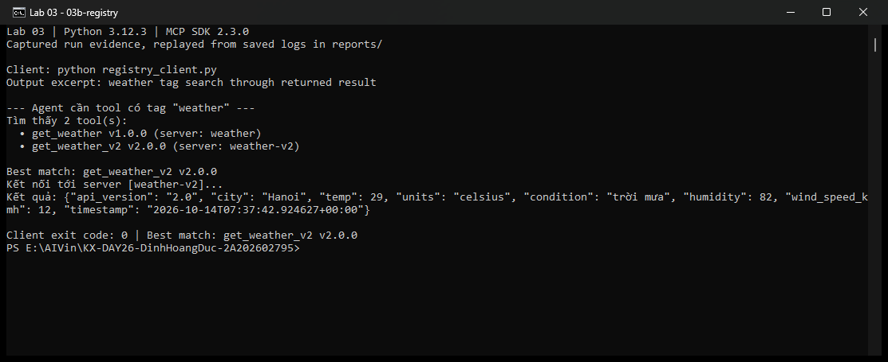
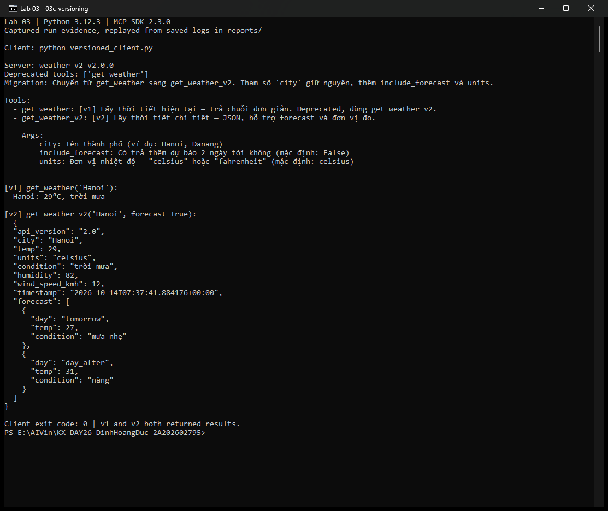
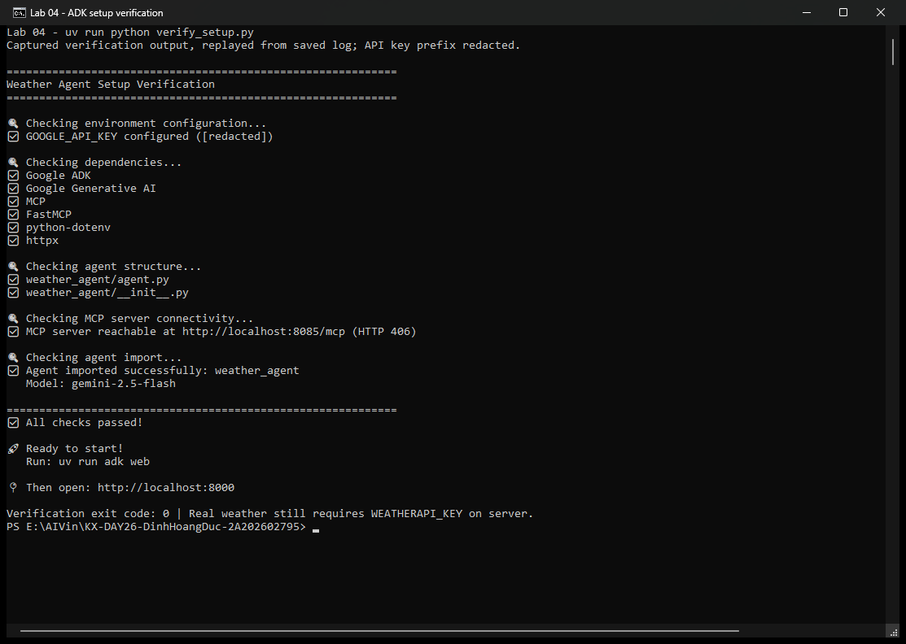
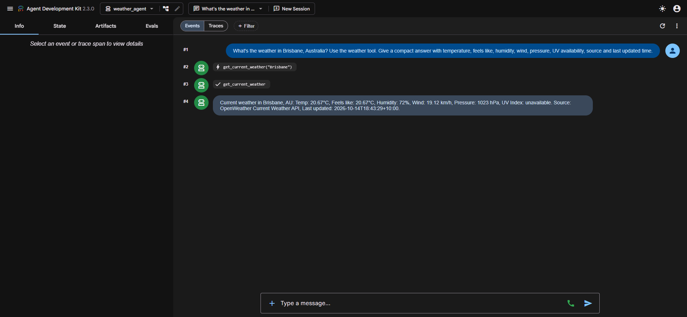
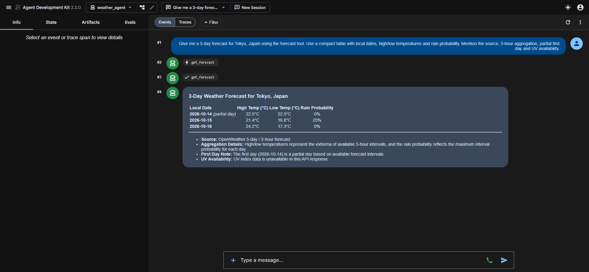

# Báo cáo Lab — Function Calling và MCP

Ngày thực hiện: 14/10/2026 (Asia/Saigon).

Nguồn thời tiết thật đã được đổi sang **OpenWeather** theo yêu cầu của người thực hiện. Luồng ADK → MCP → REST giữ nguyên; dữ liệu OpenWeather không được ghi là WeatherAPI. Hai endpoint OpenWeather đang dùng không có UV. Phần cuối báo cáo ghi trạng thái checkpoint so với đề gốc.

## Bước 1 — Function Calling thuần

### 1. Mục tiêu và phạm vi

Chạy `01-function-calling/weather_function_calling.py` với Gemini để quan sát luồng: model yêu cầu gọi tool → app chạy hàm Python → app gửi kết quả lại → model tổng hợp câu trả lời.

Báo cáo sử dụng output từ lần chạy Gemini thực tế, kết thúc với mã thoát `0`. **Dữ liệu thời tiết là mock có sẵn trong mã nguồn**, không phải thời tiết đo được ngày thực hiện. Bước này chưa gọi API thời tiết thật.

### 2. Môi trường và cách chạy

| Thành phần | Giá trị đã kiểm tra |
| --- | --- |
| Môi trường Python | WSL, dùng `.venv/bin/python` có sẵn trong repo |
| Python | 3.12.3 |
| Google Gemini SDK (`google-genai`) | 2.30.1 |
| Model được cấu hình | `gemini-2.5-flash` |
| Xác thực | `GEMINI_API_KEY`, nạp từ `.env` ở thư mục gốc |
| Câu hỏi | Thời tiết Hà Nội và Đà Nẵng hôm nay thế nào? |

File `.env` được Git bỏ qua. API key không được đưa vào báo cáo, log hoặc ảnh.

Lệnh đã dùng trong PowerShell; nạp `.env` trước khi chạy vì file lab không tự đọc file này:

```powershell
wsl --exec /mnt/e/AIVin/KX-DAY26-DinhHoangDuc-2A202602795/.venv/bin/python -c "from dotenv import load_dotenv; import runpy; load_dotenv('/mnt/e/AIVin/KX-DAY26-DinhHoangDuc-2A202602795/.env'); runpy.run_path('/mnt/e/AIVin/KX-DAY26-DinhHoangDuc-2A202602795/01-function-calling/weather_function_calling.py', run_name='__main__')"
```

Không chỉnh sửa file Python của bài lab để lấy kết quả này.

### 3. Ba phần trong mã nguồn

Nguồn: [weather_function_calling.py](01-function-calling/weather_function_calling.py) và [README bước 1](01-function-calling/README.md).

| Phần | Vị trí trong file Python | Trách nhiệm |
| --- | --- | --- |
| Schema viết tay | Dòng 27, `get_weather_declaration = types.FunctionDeclaration(...)` | Khai báo tên `get_weather`, mô tả và tham số `city` kiểu string, bắt buộc; truyền schema cho Gemini qua `TOOLS` |
| Hàm thực thi | Dòng 45, `def get_weather(city: str) -> str` | Trả chuỗi JSON mock cho Hà Nội, Hồ Chí Minh, Đà Nẵng; có dữ liệu mặc định cho tên khác |
| Vòng lặp trong app | Dòng 90, `while resp.function_calls:` | Đọc yêu cầu của model, gọi hàm thật và gửi kết quả lại cho model |

Dòng 97 là nơi thực thi tool:

```python
result = get_weather(**fc.args)
```

Sau đó app dùng `types.Part.from_function_response(...)` để đóng gói kết quả, thêm vào lịch sử hội thoại và gọi Gemini tiếp. Schema chỉ mô tả công cụ; vòng lặp trong app mới nối yêu cầu của model với hàm Python.

### 4. Output thực tế

Log nguyên văn được lưu tại [reports/01-function-calling-output.txt](reports/01-function-calling-output.txt):

```text
User: Thời tiết Hà Nội và Đà Nẵng hôm nay thế nào?

  [model yêu cầu] get_weather({'city': 'Hà Nội'})
  [app thực thi]  -> {"city": "Hà Nội", "nhiệt_độ": "29°C", "thời_tiết": "trời mưa nhẹ", "độ_ẩm": "82%", "gió": {"hướng": "Đông Nam", "tốc_độ": "12 km/h"}}
  [model yêu cầu] get_weather({'city': 'Đà Nẵng'})
  [app thực thi]  -> {"city": "Đà Nẵng", "nhiệt_độ": "30°C", "thời_tiết": "nhiều mây", "độ_ẩm": "78%", "gió": {"hướng": "Đông", "tốc_độ": "10 km/h"}}
Trả lời: Chào bạn! Dưới đây là thời tiết hôm nay ở Hà Nội và Đà Nẵng:

**Hà Nội:** 🌧️ Trời mưa nhẹ, nhiệt độ khoảng 29°C, độ ẩm 82%, gió Đông Nam 12 km/h.
*Lời khuyên:* Bạn nhớ mang theo ô hoặc áo mưa khi ra ngoài nhé!

**Đà Nẵng:** ☁️ Trời nhiều mây, nhiệt độ khoảng 30°C, độ ẩm 78%, gió Đông 10 km/h.
*Lời khuyên:* Thời tiết khá dễ chịu, bạn có thể mặc đồ thoáng mát nhé!
```

Ảnh dưới đây chụp cửa sổ terminal **hiển thị lại log đã lưu nguyên văn** của lần chạy trên. Header trong ảnh ghi rõ việc hiển thị lại; đây không phải ảnh chụp tại thời điểm gửi request đến Gemini.



### 5. Đối chiếu dữ liệu và checkpoint

| Thành phố | JSON do app trả về | Câu trả lời Gemini |
| --- | --- | --- |
| Hà Nội | 29°C; trời mưa nhẹ; độ ẩm 82%; gió Đông Nam 12 km/h | Khớp các giá trị; khuyên mang ô hoặc áo mưa |
| Đà Nẵng | 30°C; nhiều mây; độ ẩm 78%; gió Đông 10 km/h | Khớp các giá trị; khuyên mặc đồ thoáng mát |

**Checkpoint: ĐẠT.** Output có hai cặp `[model yêu cầu]` / `[app thực thi]` và dòng `Trả lời:` bằng tiếng Việt dựa trên kết quả tool. Cả hai thành phố trong câu hỏi đều được xử lý.

Các dòng `[model yêu cầu]` ghi tên và tham số từ `resp.function_calls`. Các dòng `[app thực thi]` được in sau khi app chạy `get_weather(**fc.args)`. Kết hợp log với vị trí thực thi trong mã nguồn cho thấy model chỉ sinh yêu cầu gọi hàm; app là bên chạy hàm và trả dữ liệu.

### 6. Nhận xét để so sánh với bước 2

Theo README và cách tổ chức mã nguồn của bước 1:

1. Schema được viết tay riêng với hàm nên cần đồng bộ tên và tham số khi sửa hàm.
2. Schema và hàm nằm trong app gọi Gemini; app khác muốn dùng lại cách triển khai này phải mang theo cả hai phần.
3. Schema đang dùng `types.FunctionDeclaration` của Gemini SDK; chuyển nhà cung cấp model cần thích ứng định dạng schema.

Sang bước 2, tool được tách ra MCP server để client khám phá và gọi qua MCP. Vai trò quyết định gọi tool của model vẫn giữ nguyên; nơi công bố và thực thi tool thay đổi.

## Bước 2 — Tách tool thành MCP server độc lập

### 1. Mục tiêu và môi trường

Chạy [weather_client.py](02-mcp-basics/weather_client.py) để khởi động [weather_server.py](02-mcp-basics/weather_server.py) qua stdio, khám phá tool và gọi `get_weather` cho ba thành phố. Bước này kiểm chứng lớp giao thức MCP, chưa có model tham gia và không cần API key. Thời tiết vẫn là mock trong `_MOCK_DB` của server.

| Thành phần | Giá trị đã kiểm tra |
| --- | --- |
| Python | 3.12.3, `.venv` trong WSL |
| MCP Python SDK | 2.3.0 |
| MCP server | `MCPServer("weather")` |
| Transport | stdio; client tự khởi động server như tiến trình con |
| Mã thoát của client | `0` |
| stderr của lần chạy client | Rỗng |

Đã chạy `weather_client.py` bằng Python trong `.venv`, với thư mục làm việc là `02-mcp-basics`. Lệnh tương đương khi đã kích hoạt `.venv` trong WSL:

```bash
cd 02-mcp-basics
python weather_client.py
```

### 2. Phân chia trách nhiệm trong mã nguồn

Server tạo `MCPServer("weather")` ở dòng 20. Tool được khai báo ở dòng 29–32:

```python
@mcp.tool()
def get_weather(city: str) -> str:
    """Lấy thời tiết hiện tại của một thành phố."""
    return f"{city}: {_MOCK_DB.get(city, '28°C, không có dữ liệu chi tiết')}"
```

Trong file hiện tại, khai báo tool gồm 4 dòng, so với 13 dòng `FunctionDeclaration` viết tay ở bước 1. Decorator của MCP SDK sinh schema từ chữ ký hàm và docstring; logic lấy dữ liệu nằm ở server.

Client dùng `StdioServerParameters(command=sys.executable, args=["weather_server.py"])` ở dòng 25. `sys.executable` đảm bảo server dùng cùng Python với client. Client mở `ClientSession`, gọi `initialize()` rồi `list_tools()` ở dòng 32; sau đó gọi `call_tool(...)` ở dòng 39 và in `result.content[0].text` nhận về. Vì đường dẫn server là tương đối, cần chạy với thư mục làm việc `02-mcp-basics`.

**Lưu ý từ mã nguồn thực tế:** danh sách và mô tả tool được khám phá lúc chạy, nhưng client mẫu vẫn hard-code tên `"get_weather"`, khóa tham số `"city"` và danh sách `["Hanoi", "Danang", "Haiphong"]` khi gọi. Client chưa tự lấy tên tool từ kết quả `list_tools()` để chọn tool. Điều này không ảnh hưởng checkpoint, nhưng cần phân biệt khám phá tool với quyết định gọi tool.

### 3. Output thực tế

Log stdout được lưu trực tiếp từ tiến trình client tại [reports/02-mcp-client-output.txt](reports/02-mcp-client-output.txt):

```text
Tools server cung cấp:
  - get_weather: Lấy thời tiết hiện tại của một thành phố.

call_tool get_weather(city='Hanoi'):
  -> Hanoi: 29°C, trời mưa

call_tool get_weather(city='Danang'):
  -> Danang: 30°C, nhiều mây

call_tool get_weather(city='Haiphong'):
  -> Haiphong: 33°C, mưa rào
```

Ảnh terminal dưới đây hiển thị lại log nguyên văn đã lưu, có đủ dòng `Tools server cung cấp:` và ba lần `call_tool`. Header ghi rõ việc hiển thị lại log của lần chạy thực tế.



### 4. Schema server công bố qua MCP

Ngoài lần chạy client mẫu, đã mở một `ClientSession` qua stdio để gọi `list_tools()` và lưu phản hồi đầy đủ tại [reports/02-mcp-tools.json](reports/02-mcp-tools.json).

| Trường trong phản hồi thực tế | Giá trị | Đối chiếu với server |
| --- | --- | --- |
| `name` | `get_weather` | Tên hàm |
| `description` | `Lấy thời tiết hiện tại của một thành phố.` | Khớp nguyên văn docstring |
| `input_schema.type` | `object` | Đối tượng chứa tham số gọi tool |
| `input_schema.properties.city.type` | `string` | Khớp `city: str` |
| `input_schema.required` | `["city"]` | Tham số không có giá trị mặc định |
| `output_schema.properties.result.type` | `string` | Khớp kiểu trả về `-> str` |

Phản hồi qua MCP xác nhận server công bố mô tả, schema đầu vào và schema đầu ra; client không cần tự viết `FunctionDeclaration` như bước 1.

### 5. Checkpoint và đối chiếu kết quả

| Thành phố | Kết quả thực tế | Đối chiếu `_MOCK_DB` |
| --- | --- | --- |
| Hanoi | `Hanoi: 29°C, trời mưa` | Khớp |
| Danang | `Danang: 30°C, nhiều mây` | Khớp |
| Haiphong | `Haiphong: 33°C, mưa rào` | Khớp |

**Checkpoint: ĐẠT.** Client liệt kê `get_weather` với mô tả đúng docstring, cả ba lần gọi trả kết quả đúng dữ liệu server và tiến trình kết thúc thành công. Log được đối chiếu với output mong đợi trong [README bước 2](02-mcp-basics/README.md).

Client không import hay chạy trực tiếp hàm `get_weather`; nó gửi yêu cầu qua `session.call_tool(...)`. Server chứa hàm thực thi, còn client nhận chuỗi kết quả qua MCP. Log kết hợp với mã nguồn hai file xác nhận sự phân chia này.

### 6. Lớp nào thay đổi, lớp nào giữ nguyên?

| Khía cạnh | Bước 1 | Bước 2 |
| --- | --- | --- |
| Khai báo schema | App viết tay `FunctionDeclaration` | MCP SDK sinh schema ở server qua `@mcp.tool()` |
| Nơi thực thi tool | Hàm Python nằm trong app gọi Gemini | Hàm Python nằm trong MCP server riêng |
| Khám phá tool | App có sẵn danh sách `TOOLS` | Client gọi `list_tools()` lúc chạy |
| Gọi tool | App chạy `get_weather(**fc.args)` | Client gửi `call_tool(...)`; server chạy hàm |
| Tái sử dụng logic tool | App khác cần mang theo schema và hàm | MCP client khác có thể kết nối cùng mã server |
| Model trong lần chạy | Gemini quyết định gọi tool và viết câu trả lời | Không có model; client gọi ba thành phố cố định |

Phần viết schema thủ công và thực thi hàm trong app được thay bằng schema server công bố và lời gọi qua MCP. Bước 2 cũng bỏ phần gọi Gemini và vòng lặp xử lý `resp.function_calls` khỏi demo để quan sát riêng giao thức.

Trong luồng đầy đủ ở bước 4, model vẫn dùng Function Calling để quyết định gọi tool; client điều phối lời gọi qua MCP, gửi kết quả lại cho model tổng hợp. MCP chuẩn hóa kết nối và việc khám phá/gọi công cụ; bản thân giao thức không yêu cầu phải có LLM.

## Bước 3 — Auth, Tool Registry và versioning

### 1. Phạm vi và môi trường

Đã chạy cả ba demo trong [03-production](03-production/README.md), dùng Python 3.12.3 và MCP SDK 2.3.0 trong `.venv` WSL. Các demo không gọi model hoặc API thời tiết; số liệu thời tiết và forecast là mock. Mã nguồn các demo được giữ nguyên.

Bốn ảnh bên dưới chụp terminal hiển thị lại bằng chứng từ log đã lưu. Ảnh auth thất bại ghép phần lỗi client, access log của server và kết quả kiểm tra HTTP; log đầy đủ được liên kết riêng. Header mỗi ảnh ghi rõ việc hiển thị lại bằng chứng.

### 3a. Authentication qua Streamable HTTP

Nguồn: [auth_server.py](03-production/auth_server.py), [auth_client.py](03-production/auth_client.py).

Server chạy tại `http://localhost:8000/mcp`, dùng `AuthSettings` và `StaticTokenVerifier`. Token hợp lệ được ánh xạ thành `AccessToken` với scope `weather:read`; hàm `get_weather` chỉ xử lý dữ liệu mock. Client gắn header Bearer vào HTTP client bằng `create_mcp_http_client(headers=...)`.

Trong lần chạy, không đặt `MCP_AUTH_TOKEN` cho server và client thành công, nên cả hai dùng token mặc định của demo. Client thất bại được chạy với `MCP_AUTH_TOKEN=wrong-token`, trong khi cấu hình token hợp lệ của server giữ nguyên.

Lệnh tương đương trong hai terminal WSL đã kích hoạt `.venv`:

```bash
# Terminal server, trong 03-production
python auth_server.py

# Terminal client, trong 03-production
python auth_client.py
MCP_AUTH_TOKEN=wrong-token python auth_client.py
```

Output của client có token hợp lệ, lưu tại [03a-auth-ok-output.txt](reports/03a-auth-ok-output.txt):

```text
Tools (có auth):
  - get_weather: Lấy thời tiết hiện tại của một thành phố.

Kết quả: Hanoi: 29°C, trời mưa
```



Client dùng token sai thoát với mã `1`, lỗi xảy ra ở `session.initialize()` trước khi liệt kê tool hoặc gọi `get_weather`. Traceback đầy đủ được lưu tại [03a-auth-fail-output.txt](reports/03a-auth-fail-output.txt); dòng lỗi cuối là:

```text
      | mcp.shared.exceptions.MCPError: Server returned an error response
```

Access log của server ghi nhận các request bị từ chối:

```text
INFO:     127.0.0.1:53026 - "POST /mcp HTTP/1.1" 401 Unauthorized
INFO:     127.0.0.1:53038 - "POST /mcp HTTP/1.1" 401 Unauthorized
INFO:     127.0.0.1:53050 - "POST /mcp HTTP/1.1" 401 Unauthorized
```

Ngoài client mẫu, đã gửi hai HTTP POST kiểm tra tới `/mcp`: một request thiếu Bearer token và một request dùng `wrong-token`. Kết quả thực tế được lưu trong [03a-auth-checks.json](reports/03a-auth-checks.json):

| Trường hợp | Kết quả thực tế |
| --- | --- |
| Client dùng token mặc định hợp lệ | Mã thoát `0`, liệt kê tool và nhận `Hanoi: 29°C, trời mưa` |
| Client dùng `wrong-token` | Mã thoát `1`, không in danh sách tool hoặc kết quả thời tiết |
| HTTP POST thiếu token | `401 Unauthorized` |
| HTTP POST dùng token sai | `401 Unauthorized` |

**Khác biệt với tài liệu:** README có dòng “token sai → 403”, trong khi sơ đồ của README ghi `401 Unauthorized`. Với SDK 2.3.0 đang cài, cả request thiếu token lẫn token sai đều trả `401`, body có `error: invalid_token` và `error_description: Authentication required`. Báo cáo ghi theo phản hồi HTTP và access log thực tế.



Server đã được dừng bằng SIGINT, tương đương Ctrl+C. Log có `Shutting down`, `Application shutdown complete` và `KeyboardInterrupt` do tín hiệu dừng; đây là phần kết thúc server chủ động. Kiểm tra sau khi tiến trình thoát xác nhận không còn dịch vụ lắng nghe tại `127.0.0.1:8000`. Log đầy đủ, gồm các cảnh báo của SDK khi khởi động, được lưu tại [03a-auth-server.log](reports/03a-auth-server.log).

### 3b. Tool Registry — tìm theo tag và chọn phiên bản

Nguồn: [registry.json](03-production/registry.json), [registry_client.py](03-production/registry_client.py).

Chạy từ `03-production`:

```bash
python registry_client.py
```

Registry có bốn mục tool. `search(tag="weather")` tìm được hai tool: `get_weather` v1.0.0 trên server `weather` và `get_weather_v2` v2.0.0 trên server `weather-v2`. `best_match()` ưu tiên các mục chưa deprecated rồi chọn phiên bản cao nhất bằng `packaging.version.Version`; nếu mọi kết quả đều deprecated, code vẫn chọn trong tập kết quả đó.

Client lấy tên tool và cấu hình server từ mục được chọn, rồi `connect_and_call()` kết nối tới `versioned_server.py` qua stdio. Việc chọn tool ở demo này là thuật toán Python, chưa có LLM tham gia. Nhánh HTTP có Bearer auth tồn tại trong code nhưng lần chạy registry này sử dụng nhánh stdio.

Output nguyên văn, gồm cả danh sách registry và tìm kiếm keyword `forecast`, được lưu tại [03b-registry-output.txt](reports/03b-registry-output.txt):

```text
=== Tool Registry ===

  get_weather v1.0.0
    Lấy thời tiết hiện tại của một thành phố
    tags: ['weather', 'current', 'vietnam']  →  server: weather
  get_weather_v2 v2.0.0
    Lấy thời tiết chi tiết — JSON, hỗ trợ forecast và đơn vị đo
    tags: ['weather', 'forecast', 'detailed', 'vietnam']  →  server: weather-v2
  send_email v1.0.0
    Gửi email tới một hoặc nhiều người nhận
    tags: ['email', 'notification', 'communication']  →  server: email-service
  query_db v1.2.0
    Chạy truy vấn SQL trên database nội bộ
    tags: ['database', 'sql', 'query', 'analytics']  →  server: db-gateway

--- Agent cần tool có tag "weather" ---
Tìm thấy 2 tool(s):
  • get_weather v1.0.0 (server: weather)
  • get_weather_v2 v2.0.0 (server: weather-v2)

Best match: get_weather_v2 v2.0.0
Kết nối tới server [weather-v2]...
Kết quả: {"api_version": "2.0", "city": "Hanoi", "temp": 29, "units": "celsius", "condition": "trời mưa", "humidity": 82, "wind_speed_kmh": 12, "timestamp": "2026-10-14T07:37:42.924627+00:00"}

--- Agent tìm tool có keyword "forecast" ---
  • get_weather_v2: Lấy thời tiết chi tiết — JSON, hỗ trợ forecast và đơn vị đo
```



**Kết quả:** client thoát với mã `0`, chọn `get_weather_v2` v2.0.0 và nhận JSON có `api_version: "2.0"`, `city: "Hanoi"`, `temp: 29`. Lời gọi chỉ truyền `city`, nên các tham số optional dùng mặc định `include_forecast=False`, `units="celsius"`; JSON không có trường `forecast`.

Trong `registry.json`, cả hai tool thời tiết đều có `deprecated: false`. Thông báo deprecated của `get_weather` ở server v2 được kiểm chứng riêng trong phần 3c; registry demo chưa đồng bộ thông tin đó từ server.

### 3c. Versioning — giữ v1 và bổ sung v2

Nguồn: [versioned_server.py](03-production/versioned_server.py), [versioned_client.py](03-production/versioned_client.py).

Chạy từ `03-production`; client tự khởi động server qua stdio:

```bash
python versioned_client.py
```

| Kỹ thuật | Bằng chứng từ mã nguồn và lần chạy |
| --- | --- |
| Tool mới song song | `list_tools()` trả cả `get_weather` và `get_weather_v2`; client gọi thành công cả hai |
| Tham số optional | `include_forecast=False`, `units="celsius"`; lần chạy registry chỉ truyền `city` vẫn thành công |
| Server metadata | `read_resource("server://info")` trả tên `weather-v2`, version `2.0.0`, `deprecated_tools: ["get_weather"]` và migration guide |

Output nguyên văn được lưu tại [03c-versioning-output.txt](reports/03c-versioning-output.txt):

```text
Server: weather-v2 v2.0.0
Deprecated tools: ['get_weather']
Migration: Chuyển từ get_weather sang get_weather_v2. Tham số 'city' giữ nguyên, thêm include_forecast và units.

Tools:
  - get_weather: [v1] Lấy thời tiết hiện tại — trả chuỗi đơn giản. Deprecated, dùng get_weather_v2.
  - get_weather_v2: [v2] Lấy thời tiết chi tiết — JSON, hỗ trợ forecast và đơn vị đo.

    Args:
        city: Tên thành phố (ví dụ: Hanoi, Danang)
        include_forecast: Có trả thêm dự báo 2 ngày tới không (mặc định: False)
        units: Đơn vị nhiệt độ — "celsius" hoặc "fahrenheit" (mặc định: celsius)
    

[v1] get_weather('Hanoi'):
  Hanoi: 29°C, trời mưa

[v2] get_weather_v2('Hanoi', forecast=True):
  {
  "api_version": "2.0",
  "city": "Hanoi",
  "temp": 29,
  "units": "celsius",
  "condition": "trời mưa",
  "humidity": 82,
  "wind_speed_kmh": 12,
  "timestamp": "2026-10-14T07:37:41.884176+00:00",
  "forecast": [
    {
      "day": "tomorrow",
      "temp": 27,
      "condition": "mưa nhẹ"
    },
    {
      "day": "day_after",
      "temp": 31,
      "condition": "nắng"
    }
  ]
}
```



**Kết quả:** client thoát với mã `0`. Tool v1 vẫn trả chuỗi `Hanoi: 29°C, trời mưa`. Tool v2 trả chuỗi chứa JSON có `api_version: "2.0"`, độ ẩm `82`, gió `12` km/h và hai ngày forecast: `tomorrow` 27°C/mưa nhẹ, `day_after` 31°C/nắng. Trường `timestamp` là thời điểm UTC do server tạo khi gọi; dữ liệu thời tiết và forecast vẫn là mock.

Deprecated là thông báo trong docstring và resource metadata; server vẫn cho phép gọi v1. Client mẫu đọc migration guide và gọi cả hai phiên bản để kiểm chứng tương thích.

### 4. Checkpoint bước 3

| Yêu cầu | Trạng thái | Bằng chứng |
| --- | --- | --- |
| Streamable HTTP có auth, token hợp lệ gọi được tool | ĐẠT | [03a-auth-ok.png](screenshots/03a-auth-ok.png) |
| Token sai bị từ chối trước khi liệt kê tool | ĐẠT, HTTP 401 thực tế | [03a-auth-fail.png](screenshots/03a-auth-fail.png) |
| Tìm theo tag, chọn `get_weather_v2` v2.0.0 | ĐẠT | [03b-registry.png](screenshots/03b-registry.png) |
| Tool v1/v2 cùng hoạt động, có metadata deprecated | ĐẠT | [03c-versioning.png](screenshots/03c-versioning.png) |
| Dừng auth server và giải phóng cổng 8000 | ĐẠT | [03a-auth-checks.json](reports/03a-auth-checks.json), `server_stopped: true`, `port_8000_released: true` |

**Checkpoint: ĐẠT.** Đủ bốn ảnh, log của từng demo và xác nhận auth server đã dừng. Bước 4 có thể dùng cổng 8000 cho giao diện ADK; hai ý được tiếp nối là kết nối MCP qua Streamable HTTP và khám phá tool lúc chạy.

## Bước 4 — Dựng MCP server gọi WeatherAPI

### 1. Môi trường riêng của server

Đã chạy `uv sync --frozen` trong `04-lab/mcp-server`, cài dependency theo `uv.lock` vào `.venv` riêng của thư mục này. Không dùng môi trường MCP SDK 2.3.0 của bước 1–3 để chạy server Lab 04.

| Thành phần | Phiên bản đã kiểm tra |
| --- | --- |
| Python | 3.12.3 |
| MCP Python SDK | 1.28.1 |
| Package `fastmcp` | 3.4.2 |
| HTTPX | 0.28.1 |
| Uvicorn | 0.49.0 |

Mã nguồn [weather.py](04-lab/mcp-server/weather.py) dùng `FastMCP` từ `mcp.server.fastmcp`. Server gọi REST của WeatherAPI ở phía dữ liệu, công bố tool qua MCP ở phía agent:

```text
ADK Agent → Streamable HTTP localhost:8085/mcp → MCP Server → REST WeatherAPI.com
```

### 2. Khởi động và kiểm tra MCP

Server đang chạy trong terminal riêng `Lab 04 - Weather MCP Server :8085`, được giữ lại để bước 5 kết nối. Lệnh khởi động tương đương trong WSL, từ thư mục `04-lab/mcp-server`:

```bash
PORT=8085 uv run --frozen python -u weather.py
```

`PORT=8085` bảo đảm nhánh `mcp.run(transport="streamable-http")` được chọn, kể cả khi stdin không phải terminal tương tác. Cổng 8085 được kiểm tra là trống trước khi khởi động.

Log thực tế tại [04-weather-server.log](reports/04-weather-server.log) có đủ ba dòng:

```text
✅ MCP server initialized with Streamable HTTP transport
🔧 Available tools: get_current_weather, get_forecast, health_check
🚀 Starting MCP server on http://0.0.0.0:8085/mcp
```

Đã mở `ClientSession` qua Streamable HTTP tới `http://localhost:8085/mcp`, gọi `initialize()`, `list_tools()` và `call_tool("health_check", {})`. Kết quả được lưu tại [04-weather-server-checks.json](reports/04-weather-server-checks.json):

| Kiểm tra | Kết quả thực tế |
| --- | --- |
| Kết nối MCP qua HTTP | Thành công |
| Danh sách tool | `get_current_weather`, `get_forecast`, `health_check` |
| `health_check()` | `✅ Weather MCP Server is running! Ready to provide weather data for Australian cities and worldwide.` |

### 3. Nguồn OpenWeather đã hoạt động

**Server đã lấy dữ liệu OpenWeather thật qua MCP.** `WEATHERAPI_KEY` chưa được cấu hình. Theo yêu cầu dùng OpenWeather, server đọc `OPENWEATHER_API_KEY` từ môi trường và chọn nguồn này khi không có WeatherAPI key. Ba tên tool và transport HTTP vẫn giữ nguyên. Nếu có `WEATHERAPI_KEY`, nhánh WeatherAPI ban đầu được ưu tiên.

Key OpenWeather được lưu tại `04-lab/mcp-server/.env` với tên `OPENWEATHER_API_KEY`. File `.env` và `.venv` đều được Git bỏ qua. Key mới gửi sau bị OpenWeather trả 401 và không thay thế key trước đã hoạt động. Hai kết quả đã che key: [key trước HTTP 200](reports/04-openweather-key-recheck.json), [key mới HTTP 401](reports/04-openweather-new-key-check.json).

Sau khi có key, cần khởi động lại server và nạp `.env`, vì `weather.py` đọc key khi module được nạp và không tự đọc file `.env`. Lệnh tương đương cho lần khởi động có key:

```bash
PORT=8085 uv run --frozen --env-file .env python -u weather.py
```

Đã kiểm chứng `initialize()`, `list_tools()`, `get_current_weather("Brisbane,AU")` và `get_forecast("Tokyo,JP", 3)` trên server HTTP. Output đầy đủ tại [04-live-mcp-weather.json](reports/04-live-mcp-weather.json); log server sau khi nạp key tại [04-weather-server-openweather.log](reports/04-weather-server-openweather.log).

Server đổi tên thành phố sang tọa độ qua [Geocoding API](https://openweathermap.org/api/geocoding-api). Dữ liệu hiện tại dùng [Current Weather API](https://openweathermap.org/api/current): nhiệt độ °C, gió m/s đổi sang km/h, thời điểm `dt` đổi sang giờ địa phương. UV được ghi `unavailable` vì endpoint này không trả trường UV.

Dự báo dùng [5-day / 3-hour API](https://openweathermap.org/api/forecast5), nhóm theo ngày địa phương và giới hạn tối đa ba ngày. Cao/thấp là cực trị của nhiệt độ tại các mốc còn có; khả năng mưa là `max(pop) × 100` trong ngày. Đây là phép tổng hợp của app, không phải dự báo ngày độc lập từ nhà cung cấp; ngày đầu có thể thiếu mốc. Kiểm tra định dạng, giới hạn ngày và dữ liệu thiếu tại [04-openweather-format-checks.json](reports/04-openweather-format-checks.json).

## Bước 5 — Kết nối Google ADK với MCP server

### 1. Setup client và giao diện

Đã cài dependency bằng `uv sync --frozen` trong `04-lab/mcp-client`, tạo `.venv` riêng theo `uv.lock`. File `04-lab/mcp-client/.env` được ghi UTF-8, chứa `GOOGLE_API_KEY`. Key cũ bị Google trả 403 do giới hạn IP; key mới được kiểm tra thành công và thay riêng tại client. File này được Git bỏ qua; giá trị key không xuất hiện trong bằng chứng.

| Thành phần | Phiên bản đã kiểm tra |
| --- | --- |
| Python | 3.12.3 |
| Google ADK | 2.3.0 |
| Google GenAI SDK | 2.10.0 |
| MCP Python SDK | 1.28.1 |
| Model cấu hình trong agent | `gemini-2.5-flash` |
| Model thay thế qua `.env` | `GEMINI_MODEL=gemini-3.5-flash-lite` |
| MCP endpoint | `http://localhost:8085/mcp` |

Đã chạy `uv run --frozen adk web` trong terminal riêng `Lab 04 - Google ADK Web :8000`, giữ MCP server cổng 8085 chạy song song. Giao diện tại `http://localhost:8000/dev-ui/?app=weather_agent` đã mở bằng trình duyệt Chrome riêng cho bài lab và chọn `weather_agent`. Cấu trúc giao diện được lưu tại [04-adk-ui-snapshot.txt](reports/04-adk-ui-snapshot.txt); log web tại [04-adk-web.log](reports/04-adk-web.log).

### 2. Verification thực tế

Đã chạy script có sẵn từ thư mục client:

```bash
uv run --frozen python verify_setup.py
```

Tiến trình kết thúc với mã `0` và in `✅ All checks passed!`. GET thuần tới endpoint MCP trả HTTP `406`; script coi kết nối đạt vì server đã phản hồi với mã dưới 500. Import `root_agent` thành công, tên agent là `weather_agent`, model là `gemini-2.5-flash`.

Log tại [04-verify-setup-output.txt](reports/04-verify-setup-output.txt) được giữ nguyên nội dung kiểm tra, riêng phần API key mà script in ra đã được thay bằng `[redacted]` trước khi lưu. Ảnh dưới đây chụp terminal hiển thị lại phần output verification đã che key:



Ngoài script verification, đã import `root_agent` và gọi trực tiếp `await root_agent.tools[0].get_tools()` qua ADK. Kết quả khám phá thực tế có đủ `get_current_weather`, `get_forecast`, `health_check`; agent có MCP toolset và không dùng fallback agent không có tool. Kết quả được lưu trong [04-adk-setup-checks.json](reports/04-adk-setup-checks.json).

Kiểm tra này xác nhận kết nối MCP thực sự, vì việc tạo `McpToolset` và dòng log “Remote MCP connection successful” lúc import chưa đủ chứng minh đã gọi `list_tools()` thành công. Script `verify_setup.py` cũng không kiểm tra WeatherAPI key hoặc nội dung thời tiết.

### 3. Vai trò ADK trong luồng đầy đủ

Nguồn: [weather_agent/agent.py](04-lab/mcp-client/weather_agent/agent.py).

| Việc ADK đảm nhận | Cấu hình hoặc hành vi |
| --- | --- |
| Kết nối server | `StreamableHTTPConnectionParams(url=MCP_SERVER_URL, timeout=30.0)` |
| Khám phá tool | `McpToolset`; kiểm chứng đủ ba tool qua `get_tools()` |
| Truyền tool cho model | `Agent(model="gemini-2.5-flash", tools=[weather_tools])` |
| Điều phối Function Calling | Nhận yêu cầu tool của Gemini, gọi MCP, trả kết quả cho model tổng hợp |
| Cung cấp giao diện | `adk web` chạy tại cổng 8000 |

Code hỗ trợ `GEMINI_MODEL`, mặc định vẫn là `gemini-2.5-flash`. Lượt thời tiết hiện tại dùng 2.5 Flash thành công. Ba lượt dự báo với model này gặp HTTP 503; 2.5 Flash-Lite trả 404, vì vậy đã cấu hình 3.5 Flash-Lite cho lượt dự báo. [Tài liệu Google](https://ai.google.dev/gemini-api/docs/models/gemini-3.5-flash-lite) xác nhận model thay thế hỗ trợ Function Calling. Thay đổi này được ghi rõ để người chấm biết model của từng bằng chứng.

### 4. Kết quả chat thời tiết thật

| Yêu cầu | Trạng thái |
| --- | --- |
| `.env` client UTF-8 có Gemini key | ĐẠT |
| `verify_setup.py` báo All checks passed | ĐẠT, có `screenshots/04-verify-setup.png` |
| ADK khám phá ba MCP tool, không fallback | ĐẠT |
| Giao diện `weather_agent` ở cổng 8000 | ĐÃ MỞ |
| Câu hỏi thời tiết hiện tại có cảm giác như, độ ẩm và thời điểm cập nhật | ĐẠT với OpenWeather; UV không có trong endpoint |
| Dự báo theo ngày có nhiệt độ cao/thấp và khả năng mưa | Tổng hợp các mốc OpenWeather 3 giờ; không dùng dữ liệu mock |
| `screenshots/04-adk-current.png`, `screenshots/04-adk-forecast.png` | Ảnh chụp trực tiếp ADK, có câu hỏi, tool call và trả lời |

**Luồng dữ liệu thật dùng OpenWeather theo yêu cầu đổi nguồn.** So với đề gốc, tiêu chí nguồn WeatherAPI và chỉ số UV vẫn chưa được đáp ứng. Bằng chứng không được ghi là WeatherAPI.

Lượt hiện tại: Gemini 2.5 Flash gọi `get_current_weather("Brisbane")`. Kết quả tool và câu trả lời cùng có nhiệt độ 20,67°C, cảm giác như 20,67°C, độ ẩm 72%, gió 19,12 km/h, áp suất 1023 hPa, thời điểm `2026-10-14T18:43:29+10:00`. UV được trả rõ là không có. Nội dung câu hỏi, sự kiện gọi tool, function response và trả lời lưu tại [04-adk-current-chat.txt](reports/04-adk-current-chat.txt).



Lượt dự báo dùng Gemini 3.5 Flash-Lite. Chi tiết tool và câu trả lời tại [04-adk-forecast-chat.txt](reports/04-adk-forecast-chat.txt).

Log ADK của hai giai đoạn: [thời tiết hiện tại và các lỗi 503](reports/04-adk-web-current.log), [dự báo với model thay thế](reports/04-adk-web-forecast.log). Bằng chứng sự kiện tool được đọc từ giao diện ADK; không lưu header xác thực của request mạng.

| Ngày Tokyo | Cao/thấp trong tool (°C) | Cao/thấp trong trả lời (°C) | Xác suất mưa lớn nhất theo mốc |
| --- | --- | --- | --- |
| 2026-10-14, còn 1 mốc | 22,46 / 22,46 | 22,5 / 22,5 | 0% |
| 2026-10-15, 8 mốc | 21,36 / 16,80 | 21,4 / 16,8 | 25% |
| 2026-10-16, 8 mốc | 24,18 / 17,34 | 24,2 / 17,3 | 0% |

Các số trong câu trả lời khớp tool sau khi làm tròn một chữ số thập phân. Lượt MCP kiểm tra trước đó có hai mốc còn lại của ngày 14/10; lượt chat sau chỉ còn một mốc. Report giữ riêng hai output theo thời điểm gọi, không gán dữ liệu lần trước cho ảnh chat sau.



## Tùy chọn — Deploy MCP server lên Cloud Run

### 1. Chuẩn bị theo tài liệu Google Cloud

Đã đối chiếu [deploy từ source](https://docs.cloud.google.com/run/docs/deploying-source-code), [container contract](https://docs.cloud.google.com/run/docs/container-contract) và [cấu hình secrets](https://docs.cloud.google.com/run/docs/configuring/services/secrets). Lệnh dự kiến và cách chuyển client sang URL thật được ghi trong [04-lab/CLOUD_RUN.md](04-lab/CLOUD_RUN.md).

Đã tạo `.dockerignore` và `.gcloudignore` trong thư mục server để chỉ đưa file build vào context/upload. [Gói source](reports/weather-mcp-cloud-run-source.zip) có đúng năm file: `Dockerfile`, `pyproject.toml`, `weather.py`, `.dockerignore`, `.gcloudignore`; không chứa `.env`, `.venv` hoặc Gemini key.

### 2. Lỗi dependency được phát hiện và sửa trước deploy

Dockerfile gốc build image thành công, nhưng lần chạy container đầu tiên lỗi import `mcp.server.fastmcp`. Nguyên nhân: `pip install -e .` cài MCP 2.3.0 từ constraint không có giới hạn major, trong khi server Lab 04 sử dụng API FastMCP của SDK 1.x. Lỗi thực tế được lưu tại [05-cloud-run-initial-import.txt](reports/05-cloud-run-initial-import.txt).

Đã sửa riêng dependency server thành `mcp[cli]>=1.16.0,<2` trong [pyproject.toml](04-lab/mcp-server/pyproject.toml) và cập nhật [uv.lock](04-lab/mcp-server/uv.lock). Dockerfile giữ nguyên; `weather.py` sau đó được bổ sung nguồn OpenWeather. Môi trường bước 1–3 vẫn dùng SDK 2.x.

### 3. Kết quả kiểm tra container local

Đã build lại image `weather-mcp:cloud-run-lab`, chạy bằng CMD mặc định `python weather.py`, đặt `PORT=8080`, ánh xạ riêng cổng local `127.0.0.1:8086` để giữ MCP server 8085 và ADK 8000 đang chạy.

| Kiểm tra thực tế | Kết quả |
| --- | --- |
| `docker build` sau khi sửa dependency | Thành công, mã thoát `0` |
| MCP SDK trong image | 1.30.0 |
| Chọn Streamable HTTP với `PORT=8080` | Thành công |
| GET thuần tại `/mcp` sau startup | HTTP `406` |
| MCP `initialize()` và `list_tools()` | Thành công, đủ ba tool |
| MCP `health_check()` | Trả chuỗi xác nhận Weather MCP Server đang chạy |
| `.env` và `.venv` trong `/app` của image | Không có |
| Container thử nghiệm | Đã dừng và xóa sau kiểm tra |

Bằng chứng: [build log](reports/05-cloud-run-build.log), [container log](reports/05-cloud-run-container.log) và [kết quả kiểm tra](reports/05-cloud-run-local-checks.json). Kiểm tra local này không gọi WeatherAPI và không chứng minh dữ liệu thời tiết thật.

Sau khi bổ sung OpenWeather, đã build lại image từ source cuối cùng và kiểm tra lại MCP `initialize`, `list_tools`, `health_check`: đều đạt. [Kết quả image mới](reports/05-cloud-run-updated-image-checks.json) ghi image ID; [log container mới](reports/05-cloud-run-updated-container.log) ghi startup HTTP. Container thử nghiệm không có credential và đã được xóa; ảnh nguồn ZIP đã cập nhật theo `weather.py` mới.

### 4. Trạng thái deploy thật

**CHƯA TRIỂN KHAI CLOUD RUN.** Đã nhận project ID `keen-honor-491605-r5`; hướng dẫn dùng region đề xuất `asia-southeast1`. Máy chưa có `gcloud` hoặc phiên đăng nhập Google Cloud để deploy. OpenWeather key đã hoạt động ở local. Chưa tạo service hoặc thay đổi IAM trên Google Cloud.

Khi deploy, cần ánh xạ secret vào `WEATHERAPI_KEY` hoặc `OPENWEATHER_API_KEY` theo nguồn được chọn; hướng dẫn dùng Secret Manager. `PORT` do Cloud Run cấp, code đã hỗ trợ. Client hiện chưa gửi Google identity token, nên cần lựa chọn public access cho lab hoặc bổ sung xác thực nếu service private; lựa chọn này chưa được thực hiện.

`MCP_SERVER_URL` của client vẫn dùng mặc định `http://localhost:8085/mcp`. Chỉ đổi sang `https://<service>.run.app/mcp` sau khi có URL thật. Chưa tạo `screenshots/05-cloud-run.png`; checkpoint tùy chọn cần verification trên URL Cloud Run và câu trả lời lấy dữ liệu thật từ tool.

## Kiểm tra trước khi nộp bài

Repo cá nhân: [ducdh205/KX-DAY26-DinhHoangDuc-2A202602795](https://github.com/ducdh205/KX-DAY26-DinhHoangDuc-2A202602795).

Đã mở repo bằng trình duyệt trong context mới không đăng nhập: trang hiển thị `Public`, có liên kết `Sign in` và xác nhận fork từ `VinUni-AI20k/Day26-MCP-Tools-Integration`. Tên repo đúng định dạng yêu cầu.

Đã xem lại các ảnh để kiểm tra độ rõ và việc che key. Nội dung terminal đọc được; ảnh verification chỉ có `[redacted]`; hai ảnh ADK hiển thị câu hỏi, tool và trả lời. Các file dự kiến commit được kiểm tra giá trị API key đã cấu hình và mẫu Google API key, gồm log UTF-8/UTF-16 và nội dung giải nén của source ZIP. Không có `.env` hoặc file private key trong danh sách file Git đang theo dõi.

| Checklist nộp bài | Trạng thái |
| --- | --- |
| Tên repo đúng `KX-DAY26-HoVaTen-MSSV` | ĐẠT |
| Đủ 9 ảnh bắt buộc | ĐẠT: 9/9 ảnh |
| Hai ảnh ADK có dữ liệu WeatherAPI thật | KHÁC ĐỀ GỐC: có dữ liệu OpenWeather thật theo yêu cầu đổi nguồn; không có UV |
| Các file/bằng chứng chuẩn bị commit không chứa API key | ĐẠT theo kiểm tra giá trị key, mẫu key và xem ảnh |
| Người không đăng nhập mở được repo | ĐẠT: fork public |

**Tổng theo đề gốc: 4/5 mục đạt; mục nguồn WeatherAPI còn khác yêu cầu. Chưa nộp VLearn.** Repo đã chuẩn bị báo cáo, dữ liệu thật và đủ chín ảnh. Việc dùng OpenWeather cần được ghi nhận khi chấm bài; nếu yêu cầu WeatherAPI bắt buộc, cần chạy lại hai lượt bằng WeatherAPI. Ảnh Cloud Run không bắt buộc vì chưa triển khai phần tùy chọn.

Theo yêu cầu cuối của người thực hiện, chuẩn bị commit và push repo; người thực hiện tự nộp VLearn.

### Cập nhật key được cung cấp

Người dùng cung cấp key OpenWeather. Đã lưu key ở file `.env` được Git bỏ qua và kiểm tra bằng endpoint chính thức `/data/2.5/weather` cho Brisbane. Kết quả thực tế là HTTP `401`, thông báo `Invalid API key`; không nhận được dữ liệu thời tiết. Kết quả đã loại giá trị key được lưu tại [04-openweather-key-check.json](reports/04-openweather-key-check.json).

Đây là kết quả của lần kiểm tra trước khi key hoạt động. Lần kiểm tra sau đã trả HTTP 200 và có dữ liệu thật, được ghi trong [04-openweather-key-recheck.json](reports/04-openweather-key-recheck.json). Theo [FAQ OpenWeather](https://openweathermap.org/faq#error401), key mới có thể cần vài giờ để kích hoạt. Server đã bổ sung OpenWeather sau khi kiểm tra thành công; nguồn thực tế và các giới hạn được trình bày ở bước 4–5.
